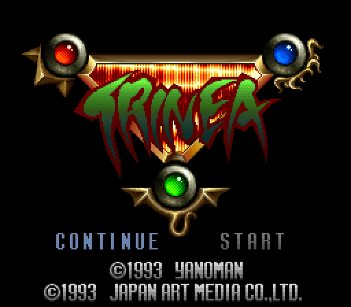
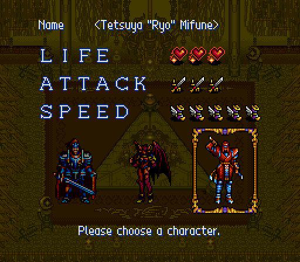
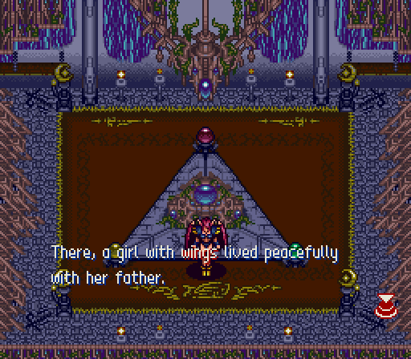
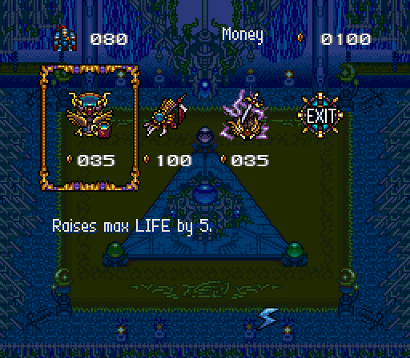
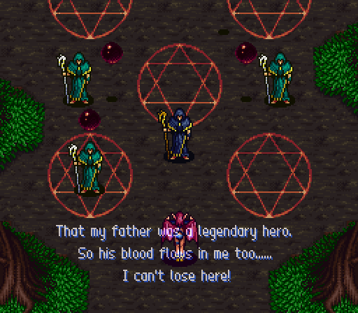
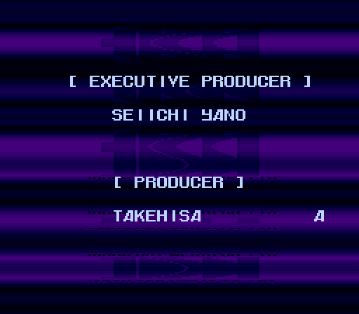

# Trinea DX (SNES)

**Trinea DX** is an enhancement project for **Trinea** (トリネア), the 1993 Super Famicom action RPG by
Yanoman / Japan Art Media (JAM). The game was released only in Japan.

The first release, **v1.0** (now **v1.0.1**), is the **complete English translation**. Speed/feel improvements and 2-player co-op
are planned next (see [Roadmap](#roadmap)).

This repository has the **source**: the English script, the English fonts, the 65816 patches and the Python build
tools. It also has a ready-made IPS patch in [`release/`](release/) and on the
[Releases page](https://github.com/struktured/trinea-dx/releases). **No ROM data is included.** Everything derived
from the game is regenerated at build time from your own legally dumped cartridge.

| | |
|---|---|
|  |  |
|  |  |
|  |  |

## What is translated

- All 841 script strings in all three hero scenarios (Hornisse, Sara, Tetsuya "Ryo" Mifune): event dialogue, choices,
  narration, the opening/ending cutscenes and the character profiles.
- The character-select screen, shop descriptions and messages, and the money label. These are pre-rendered with the
  English font because the game draws them as graphics.
- A new variable-width 8×11 dialogue font and 8×8 small-font additions, drawn for this project.
- The ROM is expanded to 32 Mbit (4 MB HiROM) to make room for the English script. The checksum is fixed.

## Patching (players)

You need the original Japanese cartridge dump:

| | |
|---|---|
| Database | No-Intro: `Trinea (Japan).sfc` |
| Format | headerless (2,097,152 bytes; remove any 512-byte copier header first) |
| MD5 | `8622b25466d1cf31e8a8771838b02ca7` |
| CRC32 | `C20419EC` |
| SHA-1 | `ba4866a599c9dc380c11f0cb3c1f8e0374d35dff` |

1. Download `Trinea (Japan) [T-En by struktured labs v1.0.1].ips` from [`release/`](release/) or from the GitHub
   Release page.
2. Apply it with any IPS patcher, for example [Flips](https://github.com/Alcaro/Flips), the web-based
   [ROM Patcher JS](https://www.marcrobledo.com/RomPatcher.js/), or Lunar IPS.
   Emulators that soft-patch (RetroArch, snes9x, bsnes) can also load the `.ips` if it sits next to the ROM with the same file name.
3. Check the patched ROM (4,194,304 bytes):
   - MD5 `62668bcd5a12b5badf034a21b8df5edc`
   - CRC32 `8EDB17F7`
   - SHA-1 `e0b232e4854b29dd181c57de54ed22cbd9f119b6`

**MiSTer / flash carts / real hardware:** pre-patch the ROM on a PC and copy the patched `.sfc` over. Do not rely
on soft-patching there. The result is a plain 32 Mbit HiROM (no enhancement chips) with a valid internal checksum.

## Building from source

Requirements: Linux, macOS or WSL with `bash`, `python3` (plus `numpy` and `Pillow`), and `git`, `cmake`, `make`
and a C/C++ compiler. The compiler is only needed the first time, to build the assembler and patcher.

```sh
git clone https://github.com/struktured/trinea-dx.git
cd trinea-dx
pip install numpy pillow          # if not already installed
tools/build.sh "/path/to/Trinea (Japan).sfc"
# -> build/trinea_en.ips   (md5 8fd7fd117a2fc701c21137c4eef92f26 for v1.0.1)
```

`tools/build.sh` does the following:

1. Verifies your ROM (MD5 and CRC32 above). It refuses headered or wrong dumps.
2. Runs `tools/get_tools.sh` on the first run, which fetches and builds
   [asar](https://github.com/RPGHacker/asar) v1.91 and [Flips](https://github.com/Alcaro/Flips) from source into
   `tools/bin/`. No third-party binaries are shipped. To use your own copies, set `ASAR=/path/to/asar FLIPS=/path/to/flips`.
3. Builds the fonts from the text glyph sources (`font/`), then encodes and word-wraps the English script
   (`script/en/`). It reads the original script structure straight from your ROM. Finally it pre-renders the system
   text (`script/en_system_layout.json`). All output goes to `build/`, which git ignores.
4. Assembles `asm/main.asm` onto a copy of your ROM with asar, checks size and checksum, and writes the IPS with Flips.

Editing the translation:

- The source of truth is `script/src/*.txt`, one `MESSAGE_ID English text` per line, using the control tags described in
  [`script/README.md`](script/README.md).
- Run `python3 tools/py/dump_script.py` (writes the Japanese dump to `build/jp/` from your ROM), then
  `python3 tools/py/merge_en.py`. This validates tags and page lengths and regenerates the English-only `script/en/*.json`.
- Then run `tools/build.sh` again.
- `script/glossary.md` and `script/TRANSLATION_NOTES.md` document the names, terms and judgement calls.
- `docs/TECHNICAL.md` covers the engine hooks (VWF, relocation, system text).

## Known caveats

- Testing: the opening of all three scenarios was played normally. Later stages, the bosses, the final cutscene and
  the Penta Dragon fight were reached with debug warps and save states, and no untranslated text turned up. The
  final-boss **win** path (defeat, then ending, then credits) was verified only by triggering the credits sequence
  directly, not by beating the final boss legitimately. Full-playthrough reports are welcome.
- A few story readings are interpretive (ninja readings, a couple of ambiguous speaker tags, a Japanese copy-paste
  error in the year gaps that the translation corrects). See `script/TRANSLATION_NOTES.md`.
- The original game's English graphics (title logo, LIFE/ATTACK/SPEED, credits) are unchanged.

## Roadmap

- **v1.0.1 (latest):** fixes dialogue text corrupting the stage collision map (getting stuck in walls / walking
  through them, e.g. after a boss victory). Please use v1.0.1 instead of v1.0.
- **v1.0:** complete English translation.
- **Planned: speed/feel improvements.** Optional tweaks for the sluggish movement and the slowdown.
- **Planned: 2-player co-op.** A two-player simultaneous mode.
- Bug-fix releases based on playtest reports. Please open an [issue](https://github.com/struktured/trinea-dx/issues)
  with a screenshot and the message location.

## Credits

- **struktured labs (Carmelo Piccione):** project lead, translation, hacking, font, tools.
- **eadmaster:** [RetroSubs](https://github.com/eadmaster/RetroSubs) English subtitles for Trinea and the character
  table files this project started from. Parts of the Sara scenario and the opening are adapted from RetroSubs.
- **4ph:** font table help ([romhacking.net forum topic 40638](https://www.romhacking.net/forum/index.php?topic=40638.0)).
- **Yanoman / Japan Art Media (JAM):** the original game (1993). All rights to Trinea belong to their respective owners.

The full list, including the tools used, is in [CREDITS.md](CREDITS.md).

## License

This repository is dual-licensed by content type:

| What | License |
|---|---|
| Translation and text: `script/` (English script, sources, glossary, notes, system-text layout), `release/readme.txt`, docs prose | [CC BY-NC-SA 4.0](LICENSE-CC-BY-NC-SA-4.0.txt) |
| Fonts drawn for this project: `font/` (glyph sources) | [CC BY-NC-SA 4.0](LICENSE-CC-BY-NC-SA-4.0.txt) |
| Table files: `tables/` (based on eadmaster's RetroSubs tables) | [CC BY-NC-SA 4.0](LICENSE-CC-BY-NC-SA-4.0.txt) |
| Code: `asm/`, `tools/` (build scripts and Python tools) | [MIT](LICENSE-MIT.txt) |

The text has to be CC BY-NC-SA 4.0 because it builds on eadmaster's RetroSubs English translation, which is
CC BY-NC-SA 4.0. The IPS patch contains both the translation and the code, so distribute it under CC BY-NC-SA 4.0
(non-commercial, with attribution, share-alike). Never distribute ROMs or pre-patched ROMs.

Trinea is © 1993 Yanoman / Japan Art Media. This is an unofficial, non-commercial fan project with no affiliation to
the rights holders. Screenshots in `docs/screenshots/` show the original game's artwork and are included only for
illustration. See [LICENSE](LICENSE).
